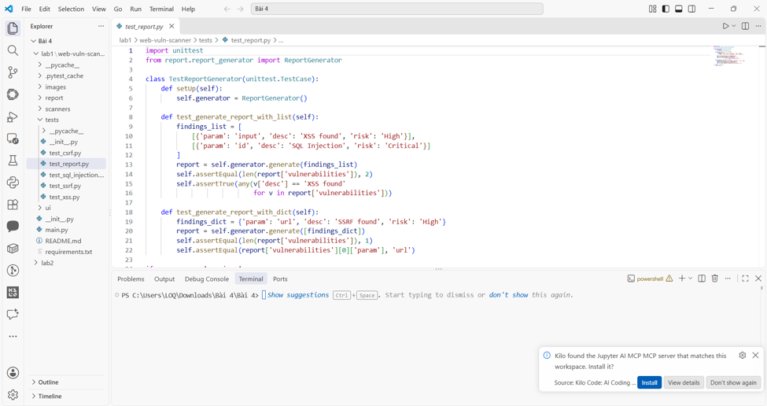
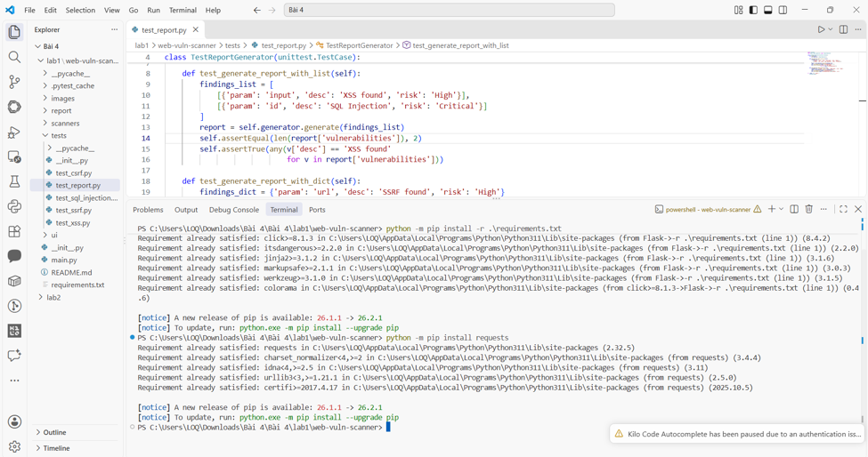
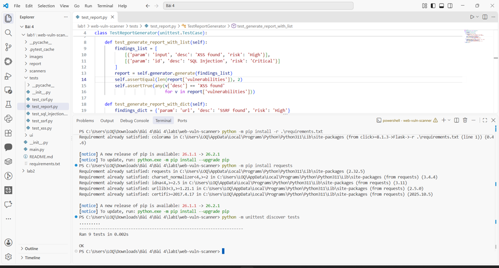
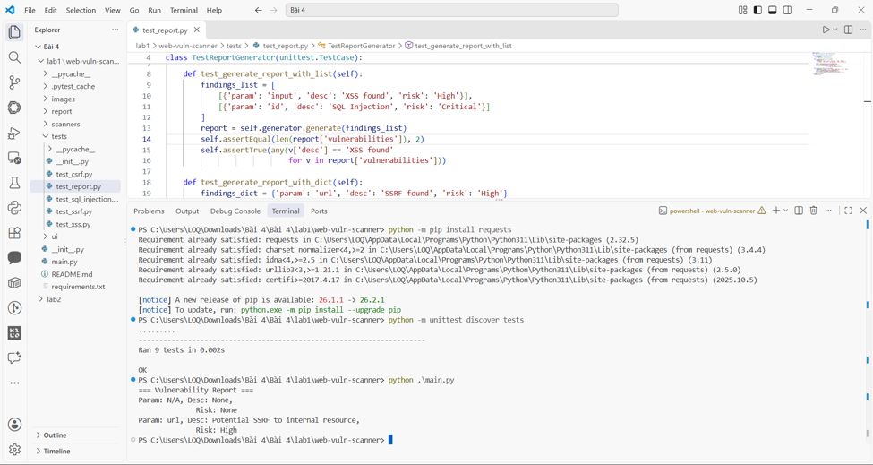
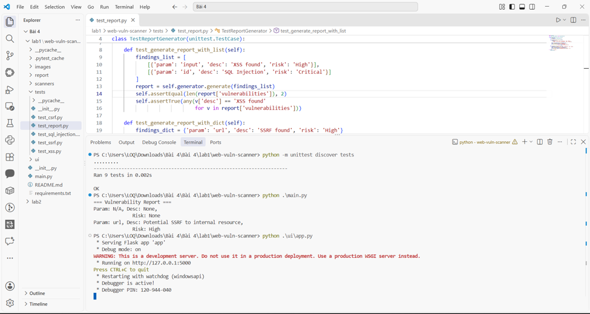
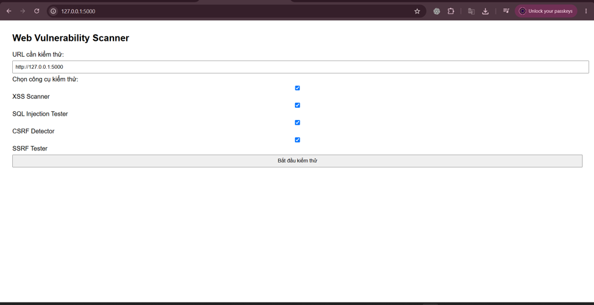
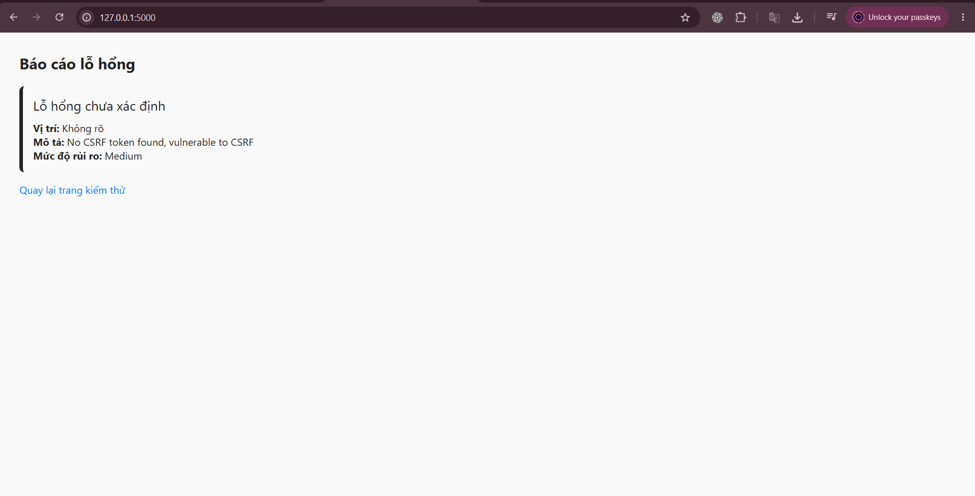
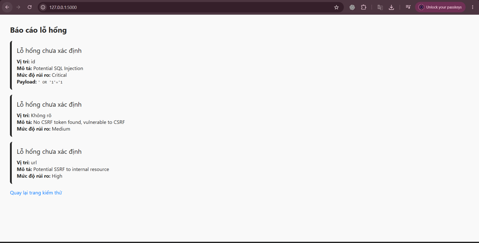
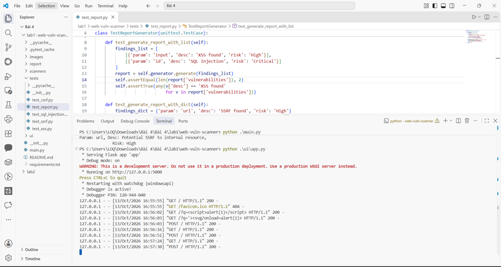

# Bài thực hành 1 – Xây dựng công cụ kiểm tra bảo mật web

- Sinh viên thực hiện: Dương Thanh Mộng
- MSSV: 2387700044
- Lớp: 23DATA1
- Học phần: Bảo mật mạng máy tính
- Nội dung tuần 4: Bảo mật ứng dụng web và API

## 1. Mục đích thực hành

Bài thực hành xây dựng chương trình Web Vulnerability Scanner bằng Python. Chương trình gồm các thành phần kiểm tra XSS, nhận diện chuỗi SQL Injection, phát hiện thiếu token CSRF và nhận diện tham số URL trỏ đến địa chỉ nội bộ có dấu hiệu SSRF. Kết quả được tổng hợp thành báo cáo và có thể xem qua giao diện Flask.

## 2. Tổ chức mã nguồn

Các chức năng được chia thành từng thư mục để thuận tiện kiểm tra và sử dụng:
```text
web-vuln-scanner/
├── __init__.py
├── main.py
├── requirements.txt
├── images/
├── report/
│   ├── __init__.py
│   └── report_generator.py
├── scanners/
│   ├── __init__.py
│   ├── csrf_detector.py
│   ├── sql_injection_tester.py
│   ├── ssrf_tester.py
│   └── xss_scanner.py
├── tests/
│   ├── __init__.py
│   ├── test_csrf.py
│   ├── test_report.py
│   ├── test_sql_injection.py
│   ├── test_ssrf.py
│   └── test_xss.py
└── ui/
    ├── app.py
    └── templates/
        ├── index.html
        └── result.html
```

Thư mục `scanners` chứa các bộ kiểm tra, `report` tổng hợp kết quả, `tests` chứa bài kiểm thử và `ui` cung cấp giao diện web. Tệp `main.py` dùng để chạy ví dụ từ dòng lệnh.



## 3. Chuẩn bị môi trường

Mở terminal tại thư mục `web-vuln-scanner`, sau đó cài các thư viện:
```powershell
python -m pip install -r .\requirements.txt
python -m pip install requests
```

Flask phục vụ giao diện web; Requests được sử dụng trong bộ kiểm tra XSS. Thông báo `Requirement already satisfied` cho biết thư viện đã có trong môi trường Python đang dùng.



## 4. Kiểm tra hoạt động của các mô-đun

Chạy bộ kiểm thử bằng lệnh:
```powershell
python -m unittest discover tests
```

Ảnh thực hiện ghi nhận `Ran 9 tests` và `OK`, tức cả 9 bài kiểm thử đều hoàn thành thành công. Kết quả này xác nhận các tình huống được viết trong bộ test, chưa thể hiện độ chính xác khi quét mọi website thực tế.



## 5. Thực thi ví dụ trên terminal

```powershell
python .\main.py
```

Chương trình sử dụng dữ liệu mẫu, gọi các bộ kiểm tra và in phần `Vulnerability Report`. Ảnh chụp có cảnh báo `Potential SSRF to internal resource` ở mức `High`.

Báo cáo còn xuất hiện dòng `Desc: None` và `Risk: None`: kết quả CSRF có token bảo vệ vẫn được đưa vào danh sách báo cáo nhưng không có hai trường mô tả và mức độ rủi ro. Đây là hạn chế của cách tổng hợp kết quả hiện tại.



## 6. Khởi chạy và truy cập giao diện

Chạy máy chủ Flask:
```powershell
python .\ui\app.py
```

Khi terminal hiển thị `Running on http://127.0.0.1:5000`, mở địa chỉ đó bằng trình duyệt. Giữ tiến trình Flask hoạt động trong suốt quá trình thao tác trên giao diện.



Trang chủ cho phép nhập URL, chọn các bộ kiểm tra và gửi yêu cầu bằng nút **Bắt đầu kiểm thử**.



## 7. Kết quả minh họa trên trình duyệt

### 7.1. Kiểm tra CSRF

Kết quả hiển thị thông báo `No CSRF token found, vulnerable to CSRF` với mức độ `Medium`.

Trong mã giao diện hiện tại, CSRFDetector nhận đoạn HTML mẫu `<html><form></form></html>` được viết sẵn. Vì vậy, kết quả này minh họa việc phát hiện thiếu token trong HTML mẫu, không xác nhận website được nhập vào có lỗ hổng CSRF.



### 7.2. Nhận diện dấu hiệu SQL Injection và SSRF

Chuỗi URL dùng cho tình huống minh họa:
```text
http://example.com/page?id=' OR '1'='1&url=http://127.0.0.1/admin
```

Khi chọn các bộ kiểm tra SQL Injection, CSRF và SSRF, giao diện hiển thị:

| Thành phần | Kết quả | Mức độ do chương trình gán |
|---|---|---|
| SQL Injection | Tham số `id` chứa chuỗi payload được nhận diện | Critical |
| CSRF | Đoạn HTML mẫu không có token CSRF | Medium |
| SSRF | Tham số `url` chứa địa chỉ nội bộ `127.0.0.1` | High |

Các thẻ có tiêu đề “Lỗ hổng chưa xác định” vì kết quả của những bộ kiểm tra này chưa cung cấp trường `type` cho mẫu giao diện. Nội dung mô tả bên dưới vẫn cho biết dấu hiệu đã được nhận diện.



## 8. Theo dõi yêu cầu tới ứng dụng

Terminal Flask ghi lại các yêu cầu GET và POST phát sinh khi mở trang và gửi form. Ảnh dưới đây thể hiện nhật ký hoạt động của ứng dụng trong quá trình thực hành.



## 9. Đánh giá kết quả và giới hạn

- **XSSScanner:** gửi yêu cầu HTTP với payload mẫu rồi tìm payload trong nội dung phản hồi. Phép kiểm tra này nhận diện phản chiếu chuỗi, chưa chứng minh JavaScript thực sự thực thi trong trình duyệt. Bộ ảnh hiện tại chưa có kết quả phát hiện XSS.
- **SQLInjectionTester:** đối chiếu giá trị tham số URL với danh sách payload. Công cụ chưa thực hiện truy vấn cơ sở dữ liệu hoặc xác minh khai thác SQL Injection.
- **CSRFDetector:** tìm một số tên trường token trong HTML. Việc thấy hoặc không thấy token theo mẫu chưa đủ để kết luận đầy đủ về cơ chế chống CSRF của ứng dụng.
- **SSRFTester:** nhận diện một số địa chỉ nội bộ trong giá trị tham số. Công cụ không xác minh máy chủ đích có thực hiện yêu cầu tới địa chỉ đó hay không.
- **ReportGenerator và giao diện:** tổng hợp và trình bày kết quả, nhưng còn hạn chế ở các trường thông tin thiếu và việc đưa kết quả không có cảnh báo vào báo cáo dòng lệnh.

Bài thực hành minh họa cách chia mô-đun, viết kiểm thử và hiển thị kết quả kiểm tra bảo mật. Các mức độ rủi ro là nhãn do chương trình gán; những dấu hiệu tìm thấy cần được xác minh thêm trước khi kết luận về lỗ hổng thực tế.
