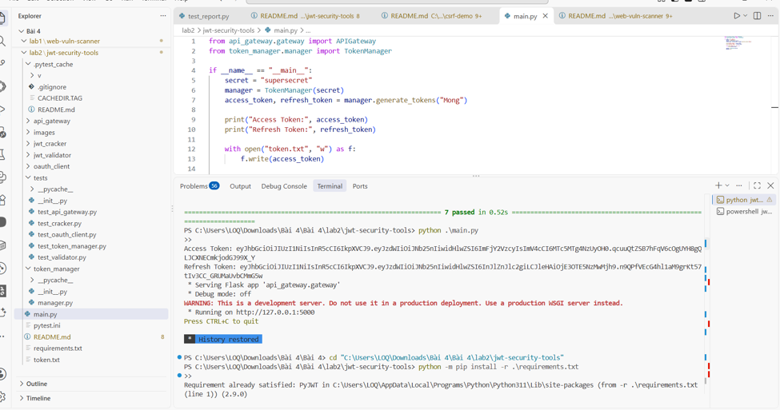
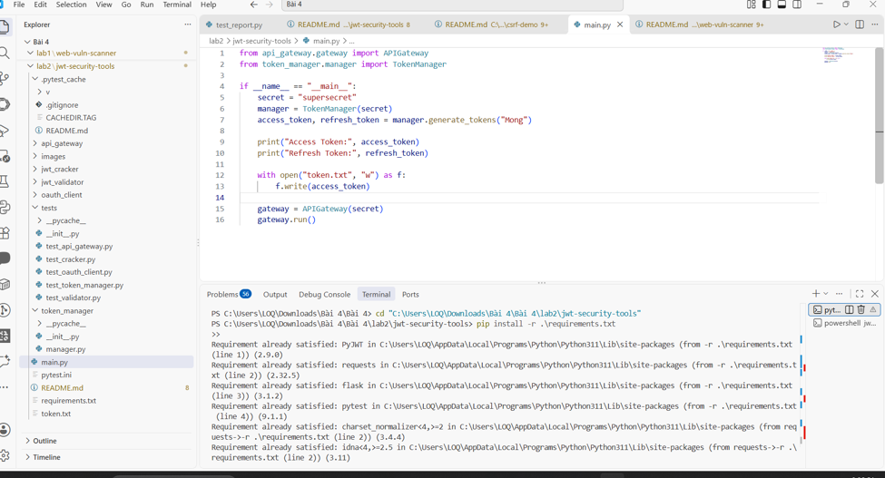
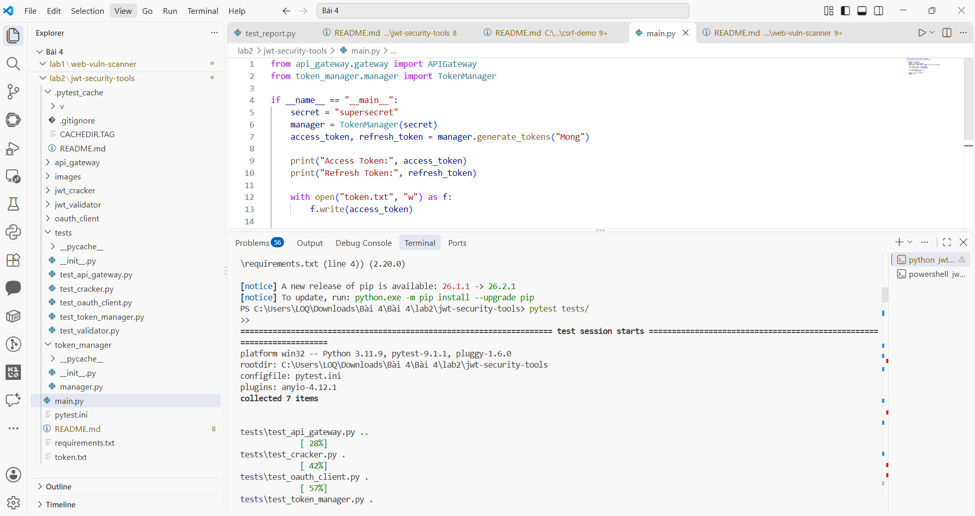
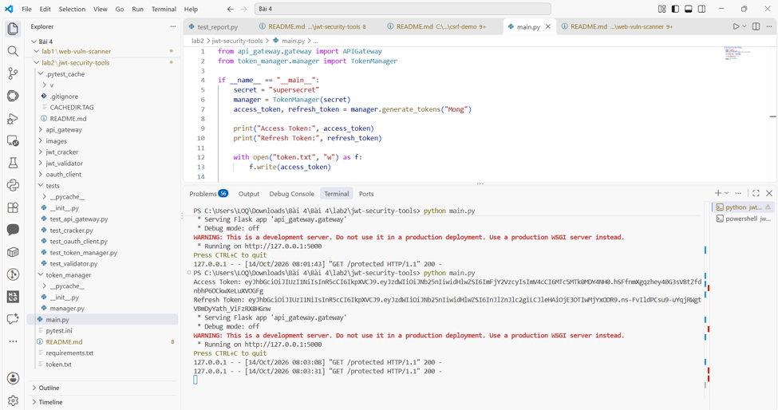
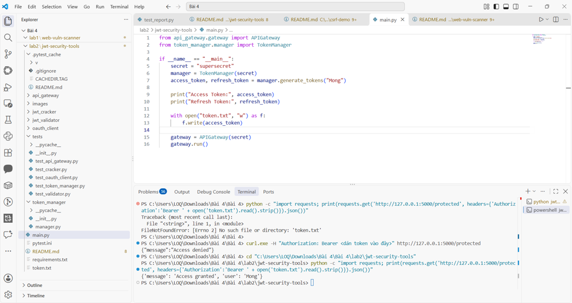

# Bài thực hành 2 – Bộ công cụ bảo mật JWT

- Sinh viên thực hiện: Dương Thanh Mộng
- MSSV: 2387700044
- Lớp: 23DATA1
- Học phần: Bảo mật mạng máy tính
- Chủ đề: Bảo mật Web App và API

## 1. Mục đích

Lab này minh họa một bộ công cụ JWT nhỏ gồm `JWTValidator`, `JWTCracker`, `OAuthClient`, `TokenManager` và `APIGateway`. Các mô-đun lần lượt kiểm tra token, thử tìm secret yếu trong wordlist, tạo URL OAuth, phát hành access/refresh token và bảo vệ một route Flask bằng JWT.

Đây là mã phục vụ học tập trong môi trường cục bộ. Secret và token xuất hiện trong ảnh chỉ dùng cho lần chạy minh họa; không dùng chúng cho hệ thống thật.

## 2. Cấu trúc dự án

```text
jwt-security-tools/
├── main.py
├── pytest.ini
├── requirements.txt
├── api_gateway/    (__init__.py, gateway.py)
├── jwt_cracker/    (__init__.py, cracker.py)
├── jwt_validator/  (__init__.py, validator.py)
├── oauth_client/   (__init__.py, client.py)
├── token_manager/  (__init__.py, manager.py)
└── tests/          (__init__.py, test_api_gateway.py, test_cracker.py,
                    test_oauth_client.py, test_token_manager.py,
                    test_validator.py)
```

Ảnh đầu tiên cho thấy cây thư mục, tệp `main.py`, terminal và tiến trình chạy ứng dụng trong VS Code.



## 3. Cài đặt phụ thuộc

Mở PowerShell tại thư mục `jwt-security-tools` và chạy:
```powershell
python -m pip install -r .\requirements.txt
```

Tệp yêu cầu gồm PyJWT để mã hóa/giải mã JWT, Flask để tạo API cục bộ, Requests cho OAuthClient và Pytest để chạy kiểm thử.



## 4. Chạy bộ kiểm thử

Sau khi cài đặt xong, chạy:
```powershell
python -m pytest tests/
```

Hoặc dùng lệnh ngắn `pytest tests/`. Kết quả mẫu thu được là `collected 7 items` và `7 passed`. Các cảnh báo về secret ngắn trong test chỉ là cảnh báo của thư viện PyJWT; chúng không làm bài test thất bại.



## 5. Khởi động chương trình chính

```powershell
python .\main.py
```

`main.py` tạo access token và refresh token cho người dùng `Mong`, in hai token ra terminal, ghi access token vào `token.txt`, sau đó khởi động API Gateway Flask tại cổng `5000`. Giữ cửa sổ này chạy để thực hiện bước gọi API.

Ảnh dưới đây ghi nhận kết quả chạy chính và log yêu cầu `GET /protected` khi gateway nhận request.



## 6. Gọi route được bảo vệ

Mở một Command Prompt hoặc PowerShell khác. Cách an toàn nhất là đọc token từ tệp mà `main.py` đã tạo:
```powershell
$token = Get-Content .\token.txt -Raw
curl.exe -H "Authorization: Bearer $token" http://127.0.0.1:5000/protected
```

Nếu token hợp lệ, API trả về dạng:
```json
{"message":"Access granted","user":"Mong"}
```

Thử token không hợp lệ:

```powershell
curl.exe -H "Authorization: Bearer invalid" http://127.0.0.1:5000/protected
```

Kết quả phải là HTTP 401 và:

```json
{"message":"Access denied"}
```

Ảnh chụp kèm cả hai tình huống xác thực để đối chiếu.



## 7. Các điểm cần quan sát trong mã

- `TokenManager` đặt `sub`, `type` và thời hạn `exp` trong token. Refresh token chỉ được dùng để cấp access token mới khi `type` là `refresh`.
- `JWTValidator` phân biệt token hợp lệ, hết hạn và sai chữ ký thông qua các ngoại lệ của PyJWT.
- `APIGateway` lấy Bearer token từ header `Authorization`, giải mã bằng secret và trả về 401 nếu token không hợp lệ.
- `JWTCracker` chỉ minh họa việc thử các secret trong wordlist trên token do chính bài lab tạo. Không dùng chức năng này với token hoặc hệ thống không được phép.
- `OAuthClient` mới xây dựng URL và gửi request token theo mẫu; bài lab không kết nối tới một nhà cung cấp OAuth thật.

## 8. Secret và Git

Trong bản mẫu học tập, `main.py` và một số test có secret viết trực tiếp để có thể chạy ngay. Khi làm dự án thật, đưa secret vào biến môi trường hoặc secret manager, không commit token hay khóa thật vào Git.

Nếu môn học yêu cầu minh họa GitSecure, có thể chạy kiểm tra theo quy trình của lớp. Ảnh hiện có trong thư mục này tập trung vào cài đặt, test, chạy gateway và xác thực API; không có ảnh commit/push nên README không gắn ảnh Git chưa được chụp.

## 9. Nhận xét

Lab cho thấy JWT không chỉ là chuỗi token được in ra màn hình: server phải kiểm tra chữ ký, thời hạn và thông tin trong payload trước khi cấp quyền. Kết quả `Access granted` chứng minh route test chấp nhận token được ký đúng secret; kết quả `Access denied` cho thấy token sai không vượt qua bước xác thực. Mức an toàn thực tế còn phụ thuộc vào secret đủ mạnh, nơi lưu trữ khóa, cơ chế thu hồi token và cấu hình triển khai.
