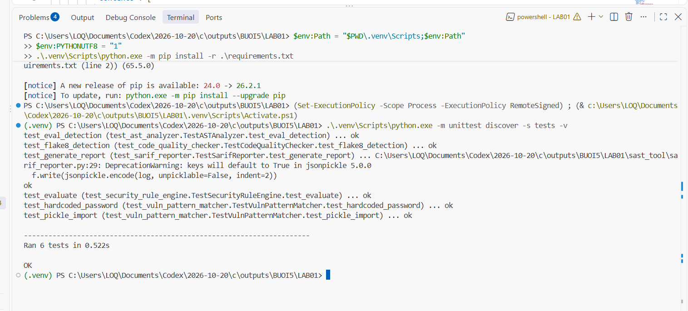
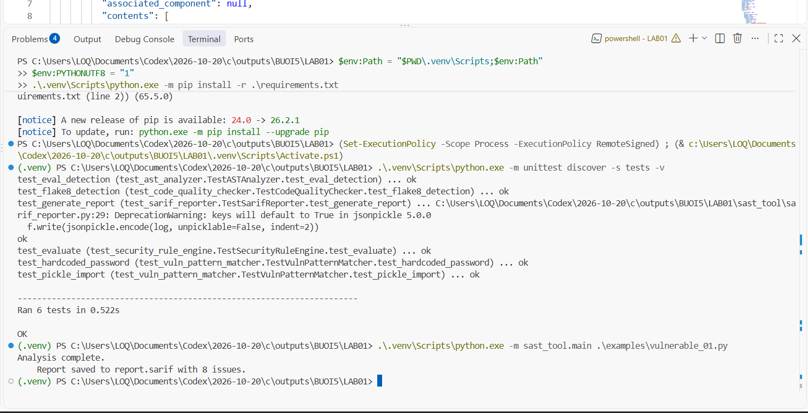
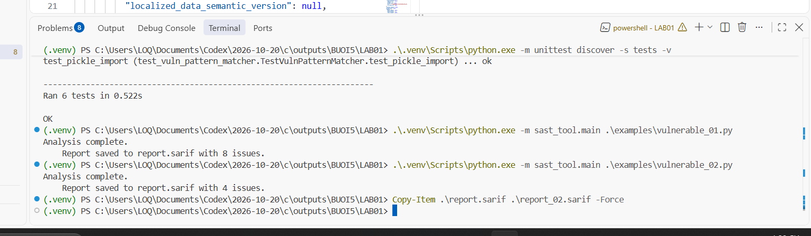
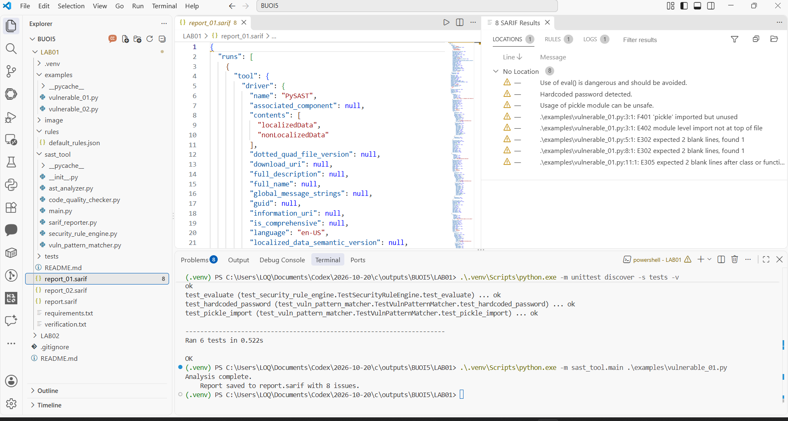
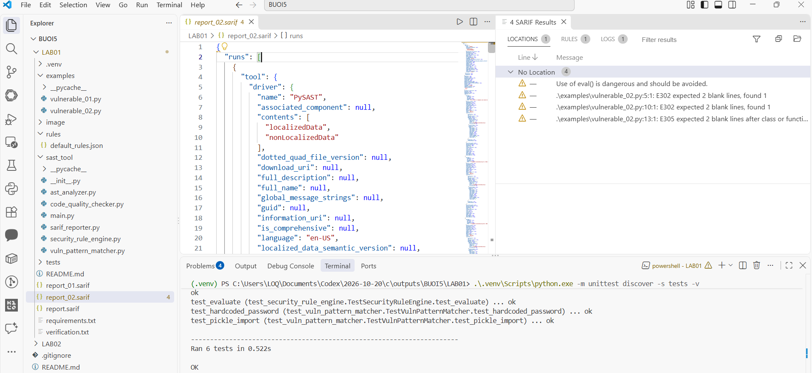
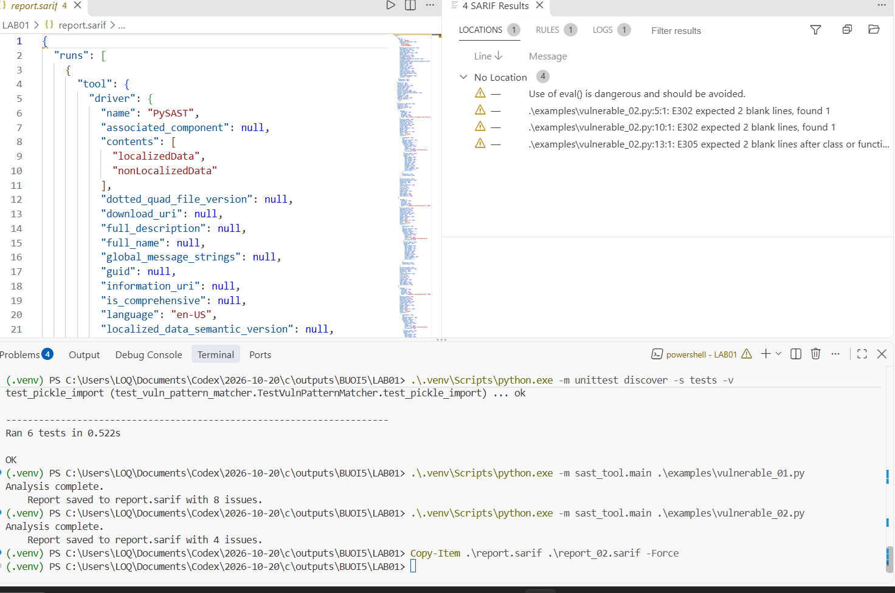

- **MSSV:** 2387700044
- **Họ và tên:** Dương Thanh Mộng
- **Lớp:** 23DATA1
- **Bài:** Bài 5 - LAB01: Thực hành SAST-TOOL

---

# Buổi 5 - LAB01: SAST-TOOL

Mã nguồn và 6 unit test được chép từ ảnh code trong `lab-05 (1).pdf`, mục 5.2, trang 4-13. Dự án đặt tại `BUOI5/lab1/sast-tool` theo cấu trúc repository; giữ nguyên package `sast_tool`, tên file, logic và dữ liệu mẫu. Không tự sửa các lỗ hổng có chủ đích trong `examples`.

## 1. Mở trong Visual Studio Code

Mở VS Code → **File → Open Folder...** → chọn thư mục **BUOI5**. Explorer cần hiện `lab1`, `lab2` và `README.md`. Mở **Terminal → New Terminal**, chọn PowerShell. Các lệnh dưới đây giả định terminal đang đứng ở BUOI5.

```powershell
cd .\lab1\sast-tool
py -m venv .venv
$env:Path = "$PWD\.venv\Scripts;$env:Path"
$env:PYTHONUTF8 = "1"
.\.venv\Scripts\python.exe -m pip install -r .\requirements.txt
```

Nếu máy không có lệnh `py`, thay `py -m venv .venv` bằng `python -m venv .venv`. Đã chạy thử bằng Python 3.11.9 trên Windows. Chỉ tạo `.venv` lần đầu; ở terminal mới vẫn cần chạy lại hai lệnh `$env:`. Chúng chỉ có tác dụng trong terminal hiện tại. Thêm thư mục Scripts vào PATH để mã gốc gọi được `flake8` bằng subprocess; cách này không cần chạy Activate.ps1 hoặc thay chính sách PowerShell.

Nhấn **Ctrl+Shift+P → Python: Select Interpreter → Enter interpreter path...** và chọn `lab1/sast-tool/.venv/Scripts/python.exe`. Nếu VS Code chưa có lệnh này, cài extension Python của Microsoft. Với tài liệu README, nhấn **Ctrl+Shift+V** để xem bản trình bày.

## 2. Chạy unit test

Trong terminal đang ở `BUOI5/lab1/sast-tool`:

```powershell
.\.venv\Scripts\python.exe -m unittest discover -s tests -v
```

Kết quả đã kiểm chứng: **Ran 6 tests ... OK**. Chụp ảnh terminal có lệnh và kết quả, lưu vào `images/01-unit-test.png`.

## 3. Phân tích ví dụ 01

```powershell
.\.venv\Scripts\python.exe -m sast_tool.main .\examples\vulnerable_01.py
Copy-Item .\report.sarif .\report_01.sarif -Force
```

Kết quả chạy thử: **8 issues**. Có cảnh báo `eval`, hardcoded password, `pickle` và các lỗi quy cách mã do flake8. Đây là thao tác đọc/phân tích mã nguồn, không thực thi `eval` trong file đầu vào. Chụp ảnh thành `images/02-sast-example-01.png`.

## 4. Phân tích ví dụ 02

```powershell
.\.venv\Scripts\python.exe -m sast_tool.main .\examples\vulnerable_02.py
Copy-Item .\report.sarif .\report_02.sarif -Force
```

Kết quả chạy thử: **4 issues**. `report.sarif` luôn bị ghi đè mỗi lần chạy; hai lệnh Copy-Item giữ riêng kết quả từng ví dụ. Hai file `report_01.sarif`, `report_02.sarif` đã có sẵn từ lần kiểm chứng. Số lỗi lint có thể thay đổi nếu chỉnh code hoặc dùng phiên bản flake8 khác. Chụp ảnh thành `images/03-sast-example-02.png`.

## 5. Xem báo cáo trong VS Code

Theo PDF: mở **Extensions → tìm SARIF Viewer (Microsoft DevLabs) → Install**. Mở `report_01.sarif` hoặc file `report.sarif` vừa tạo; dùng bảng SARIF Results nếu extension nhận báo cáo. Luôn có thể mở file dưới dạng JSON để xem nội dung. Chụp ảnh báo cáo thành `images/04-sarif-report.png`.

Đã kiểm tra việc sinh file và đọc JSON. Ngày 20/10/2026, ảnh người dùng chụp trong VS Code đã xác nhận SARIF Viewer hiển thị cả hai báo cáo: `report_01.sarif` với **8 kết quả** (`images/04-sarif-report.png`) và `report_02.sarif` với **4 kết quả** (`images/05-sarif-report-02.png`). Các kết quả hiện trong nhóm `No Location`. Việc hiển thị được danh sách kết quả chưa chứng minh báo cáo đạt toàn bộ schema SARIF; mã gốc dùng `jsonpickle` để serialize đối tượng `sarif_om`.

## 6. Cấu trúc và vai trò

```text
lab1/sast-tool/
├── examples/
│   ├── vulnerable_01.py
│   └── vulnerable_02.py
├── rules/default_rules.json
├── sast_tool/
│   ├── __init__.py
│   ├── ast_analyzer.py
│   ├── code_quality_checker.py
│   ├── main.py
│   ├── sarif_reporter.py
│   ├── security_rule_engine.py
│   └── vuln_pattern_matcher.py
├── tests/                 # 5 file test, tổng cộng 6 test case
├── images/                 # bạn tự thêm ảnh chạy bài
├── requirements.txt
├── report_01.sarif
├── report_02.sarif
├── verification.txt
└── README.md
```

ASTAnalyzer phát hiện lời gọi `eval`; VulnPatternMatcher tìm hai regex về password và import pickle; SecurityRuleEngine thêm severity theo luật; CodeQualityChecker chạy flake8; SarifReporter ghi báo cáo.

## 7. Lưu ý đúng với mã nguyên bản

- Chạy từ `lab1/sast-tool` để tìm được `rules/default_rules.json`; dùng đường dẫn **tương đối** như các lệnh ở trên. Mã tách kết quả flake8 bằng dấu `:` nên đường dẫn tuyệt đối chứa ký tự ổ đĩa Windows có thể làm bỏ sót lint.
- Không chạy bằng nút Run Python File khi đang mở `sast_tool/main.py`; dùng `-m sast_tool.main` từ thư mục LAB01 để import package đúng.
- Bộ test chất lượng mã gốc cho phép danh sách kết quả rỗng; vì vậy test này đạt không chứng minh phát hiện đầy đủ lint. Lần chạy hai ví dụ đã quan sát được 8 và 4 cảnh báo.
- `exec` trong ví dụ 02 không có rule AST riêng. Đây là bộ phát hiện nhỏ đúng theo PDF, không phải công cụ phát hiện mọi lỗ hổng Python.
- JSON báo cáo giữ cách serialize của PDF. Mã không truyền severity vào đối tượng Result, không thêm ruleId và không chuẩn hóa toàn bộ URI/schema.
- Lần kiểm chứng có `DeprecationWarning` từ jsonpickle về thay đổi mặc định trong phiên bản tương lai. Không làm test thất bại; giữ lời gọi gốc.
- Giữ `password = "123456"` và chuỗi `secret` vì là dữ liệu giả trong bài. Không thay bằng mật khẩu thật.
- Phần commit/push được thực hiện khi bàn giao thư mục BUOI5 lên repository; giữ nguyên các chuỗi mẫu của bài để kết quả phân tích vẫn khớp giáo trình.

## 8. Kết quả kiểm chứng và ảnh của bạn

Ngày kiểm chứng: 20/10/2026. **6/6 test đạt**, hai lần phân tích thành công, báo cáo lần lượt có **8** và **4** kết quả. Log thật trong `verification.txt`. Thư viện trực tiếp đã dùng: flake8 7.4.1, sarif-om 1.0.4, jsonpickle 4.1.4; `requirements.txt` giữ cách không khóa phiên bản của PDF.

Các ảnh dưới đây là ảnh thực hành người dùng đã gửi và được kiểm tra trước khi lưu; không dùng ảnh tạo giả.

**Unit test: 6 test đạt, kết quả OK.**



**Chạy SAST cho ví dụ 01: 8 issues.**



**Chạy SAST cho ví dụ 02: 4 issues và lưu bản sao report_02.sarif.**



**SARIF Viewer hiển thị báo cáo ví dụ 01: 8 kết quả.**



**SARIF Viewer hiển thị báo cáo ví dụ 02: 4 kết quả.**



Ảnh bổ sung trong `images`: `00-tao-moi-truong.png`, `00-cau-truc-lab01.png`, `00-cai-thu-vien.png`, `00-mo-bang-sarif.png`.

**Ảnh tổng hợp sau khi chạy ví dụ 02:** terminal hiển thị 4 issues, lệnh sao chép báo cáo và SARIF Viewer hiển thị 4 kết quả của report.sarif vừa sinh.



Đã đủ bộ ảnh thực hành LAB01: unit test, chạy hai ví dụ và xem hai báo cáo bằng SARIF Viewer.
