- **MSSV:** 2387700044
- **Họ và tên:** Dương Thanh Mộng
- **Lớp:** 23DATA1
- **Bài:** Bài 5 - LAB02: Thực hành DAST-TOOL

---

# Buổi 5 - LAB02: DAST-TOOL

Mã nguồn và 5 unit test được chép từ ảnh code trong `lab-05 (1).pdf`, mục 5.4, trang 16-23. Dự án đặt tại `BUOI5/lab2/dast-tool` theo cấu trúc repository; tên module, endpoint và logic giữ theo đề.

## 1. Chuẩn bị trong VS Code

Mở **File → Open Folder... → BUOI5**, sau đó **Terminal → New Terminal**, chọn PowerShell. Các lệnh sau giả định terminal đang đứng ở BUOI5:

```powershell
cd .\lab2\dast-tool
py -m venv .venv
$env:Path = "$PWD\.venv\Scripts;$env:Path"
$env:PYTHONUTF8 = "1"
.\.venv\Scripts\python.exe -m pip install -r .\requirements.txt
```

Nếu không có `py`, dùng `python -m venv .venv`. Chỉ tạo môi trường lần đầu. Terminal mới cần đặt lại các biến `$env:`; không cần đổi chính sách PowerShell hoặc kích hoạt Activate.ps1. Nhấn **Ctrl+Shift+P → Python: Select Interpreter** và chọn `lab2/dast-tool/.venv/Scripts/python.exe`. Cài extension Python của Microsoft nếu chưa có lệnh chọn interpreter.

## 2. Chạy unit test

```powershell
.\.venv\Scripts\python.exe -m unittest discover -s tests -v
```

Kết quả đã kiểm chứng: **Ran 5 tests ... OK**. Chụp terminal vào `images/01-unit-test.png`.

## 3. Chạy bản dòng lệnh

```powershell
.\.venv\Scripts\python.exe .\main.py
```

Chương trình chờ khoảng một giây để lấy CPU, sau đó in:

- PID của tiến trình Python hiện tại.
- CPU Usage, Memory Usage (RSS, đơn vị byte), Open Files.
- Memory Leaks và `Overflow Test: True` cho `2**64`.
- Network Stats của từng card mạng.
- `Suspicious Calls: ['os.system', 'eval', 'exec']`.
- `Sandbox stdout: Hello Sandbox` và stderr rỗng.

PID, CPU, RAM, file đang mở và số liệu mạng tùy máy/thời điểm. Chụp terminal vào `images/02-main.png`.

## 4. Chạy Flask API trong terminal thứ nhất

Để đối chiếu đúng cách chạy ở trang 23 PDF, chạy trực tiếp `app.py` bằng Python của LAB02. Mã gốc bind `0.0.0.0:5000`, không chỉnh sửa file:

```powershell
.\.venv\Scripts\python.exe .\app.py
```

Giữ terminal này chạy, chụp ảnh lệnh cùng thông báo Flask thành `images/03-flask-server.png`. Cần thấy `Running on all addresses (0.0.0.0)` và URL `http://127.0.0.1:5000`; địa chỉ LAN tùy máy. Nhấn Ctrl+C khi kết thúc.

Lựa chọn bổ sung để chỉ lắng nghe loopback khi thực hành tại máy cá nhân:

```powershell
.\.venv\Scripts\python.exe -m flask --app app run --host 127.0.0.1 --port 5000
```

Lệnh CLI bổ sung vẫn dùng cùng app và endpoint nhưng không tái hiện cách khởi chạy trực tiếp trong PDF. Dừng server hiện tại bằng Ctrl+C trước khi đổi cách khởi chạy để tránh trùng cổng. API `/api/sandbox` nhận và thực thi lệnh shell, không có xác thực; chỉ thực hành trong môi trường bạn kiểm soát và không mở dịch vụ ra Internet.

## 5. Gọi API trong terminal thứ hai

Chọn **Terminal → New Terminal**. Không cần kích hoạt venv cho các lệnh HTTP PowerShell sau. Giữ server ở terminal đầu tiếp tục chạy.

### Giám sát tiến trình

```powershell
Invoke-RestMethod -Uri 'http://127.0.0.1:5000/api/monitor' | ConvertTo-Json -Depth 8
```

Kết quả có `cpu_usage`, `memory_usage`, `open_files`. Yêu cầu mất khoảng một giây do phép lấy mẫu CPU. Chụp `images/04-api-monitor.png`.

### Kiểm tra bộ nhớ

```powershell
Invoke-RestMethod -Uri 'http://127.0.0.1:5000/api/memory' | ConvertTo-Json -Depth 8
```

Kết quả có `memory_leaks` là chuỗi (thường `"[]"`) và `overflow_test: true`. Chụp `images/05-api-memory.png`.

### Thống kê mạng

```powershell
Invoke-RestMethod -Uri 'http://127.0.0.1:5000/api/network' | ConvertTo-Json -Depth 8
```

Kết quả `network_stats` chứa từng card mạng và các bộ đếm byte/gói. Chụp `images/06-api-network.png`.

### Kiểm tra chuỗi lời gọi

```powershell
Invoke-RestMethod -Uri 'http://127.0.0.1:5000/api/security' | ConvertTo-Json -Depth 8
```

Kết quả `suspicious_calls` gồm `os.system`, `eval`, `exec`. Chụp `images/07-api-security.png`.

### Chạy lệnh minh họa sandbox

```powershell
$body = @{ command = 'echo Hello Sandbox' } | ConvertTo-Json
Invoke-RestMethod -Uri 'http://127.0.0.1:5000/api/sandbox' -Method Post -ContentType 'application/json' -Body $body | ConvertTo-Json -Depth 8
```

Kết quả `stdout` chứa `Hello Sandbox`, `stderr` rỗng. Chụp `images/08-api-sandbox.png`. Endpoint này phải dùng POST và JSON có trường `command`; nhập URL vào thanh địa chỉ trình duyệt sẽ gửi GET và nhận 405.

Bốn endpoint GET có thể mở trực tiếp bằng trình duyệt để xem JSON. Đường dẫn gốc `/` không có route nên trả 404 là đúng với mã gốc.

## 6. Giới hạn cần trình bày đúng khi báo cáo

- VirtualSandbox chỉ đổi thư mục làm việc sang thư mục tạm rồi dùng `subprocess.run(..., shell=True)`. Không có VM/container, không giới hạn quyền, không cách ly mạng hoặc filesystem. Chỉ chạy lệnh demo đã biết như `echo`.
- Hàm sandbox không đặt timeout, không kiểm tra exit code và không tự xóa thư mục tạm. Không gửi lệnh chạy vô hạn; nếu gặp tiến trình con còn hoạt động phải dừng tiến trình đó riêng.
- SecurityBehaviorChecker đọc chính file `security_behavior_checker.py` rồi tìm chuỗi. Danh sách lời gọi nằm sẵn trong file nên kết quả có ba chuỗi không chứng minh đã theo dõi lời gọi thật ở runtime.
- MemoryAnalyzer chỉ xem `gc.garbage` sau `gc.collect()`. Danh sách rỗng không chứng minh ứng dụng không có rò rỉ bộ nhớ.
- `check_overflow` chỉ kiểm tra `int` có trị tuyệt đối lớn hơn `2**63`. Python dùng số nguyên độ dài tùy ý; bài không phát hiện buffer overflow hay giới hạn chính xác toàn bộ miền số nguyên 64-bit.
- NetworkTrafficAnalyzer đọc bộ đếm card mạng toàn hệ thống bằng psutil; không bắt gói, không tách lưu lượng của một tiến trình, không phát hiện C2 hay exfiltration.
- API monitor quan sát chính tiến trình Flask. CLI main.py quan sát chính tiến trình main.py. Không truyền PID ứng dụng ngoài trong mã gốc.
- Unit test của PDF kiểm tra hành vi đơn giản; 5/5 test đạt không chứng nhận công cụ DAST có đủ mọi khả năng nêu trong phần lý thuyết.
- `app.py` không xử lý JSON sai/thiếu command hoặc lỗi quyền psutil một cách đầy đủ. Các yêu cầu hợp lệ trong hướng dẫn đã được chạy thử; không nâng cấp mã vì yêu cầu giữ nguyên.

## 7. Kết quả kiểm chứng và ảnh

Ngày 20/10/2026, Windows/Python 3.11: **5/5 test đạt**, `main.py` kết thúc thành công, kiểm tra cả **5 endpoint trên HTTP loopback đều trả 200**. Đã kiểm tra lại bằng đúng lệnh `python app.py` của PDF trên cổng 5000, giữ nguyên cấu hình app.py. Lệnh `echo Hello Sandbox` cho stdout đúng, stderr rỗng. Server kiểm chứng đã được dừng. Log thật của lần chạy lại nằm trong `verification.txt`, gồm cả log Flask và các dòng HTTP 200.

Thư viện trực tiếp đã dùng: psutil 7.2.2, Flask 3.1.3. File `requirements.txt` giữ không khóa phiên bản như PDF.

Ảnh thực hành người dùng gửi ngày 20/10/2026 đã xác nhận cài thư viện thành công và chạy đủ 5 unit test: `Ran 5 tests in 1.093s`, `OK`. Các ảnh được lưu nguyên bản, kiểm tra SHA-256 khớp file nguồn trước khi chèn.

**Cài thư viện trong môi trường LAB02 thành công.**

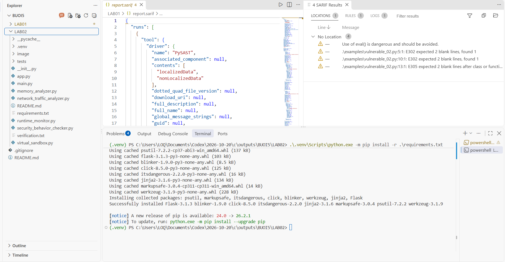

**Unit test: 5/5 test đạt, kết quả OK.**

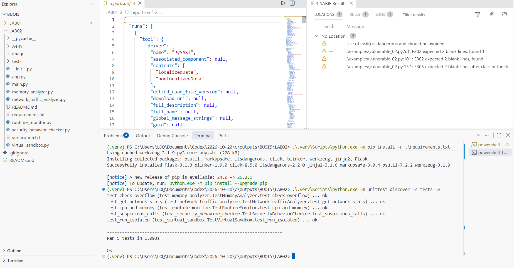

**Chạy main.py, ảnh phần đầu:** ảnh người dùng bổ sung cho thấy PID `20604`, CPU Usage `0.0`, Memory Usage `18223104`, danh sách Open Files, `Memory Leaks: []` và `Overflow Test: True`. Các số liệu tiến trình có thể thay đổi theo lần chạy.

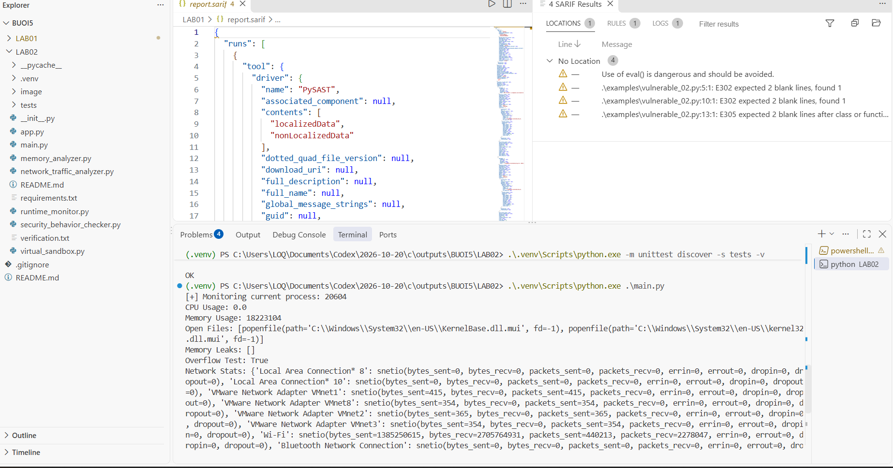

**Chạy main.py, ảnh phần cuối:** thấy `Memory Leaks: []`, `Overflow Test: True`, thống kê mạng, ba chuỗi Suspicious Calls, `Hello Sandbox`, stderr rỗng và dấu nhắc trả lại. Hai ảnh phần đầu và phần cuối đã đủ các nhóm kết quả của mẫu ở trang 23 PDF.

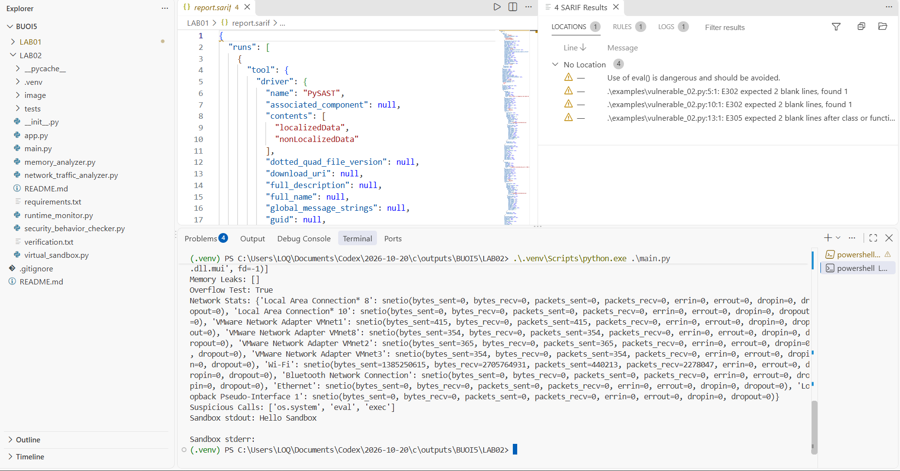

**Flask khởi chạy bằng CLI trên loopback:** ảnh xác nhận đang chạy tại `http://127.0.0.1:5000`. Đây là cách khởi chạy bổ sung; PDF dùng `python .\app.py`.

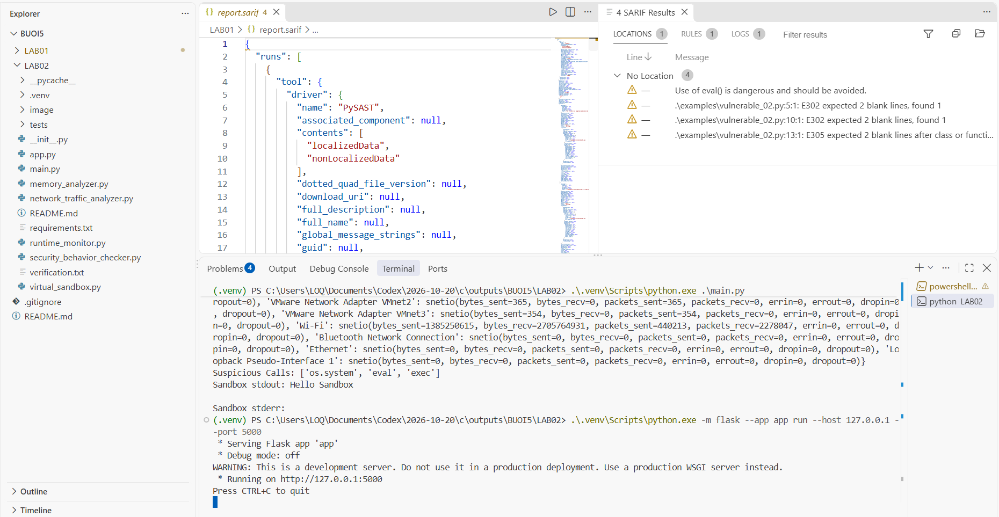

**Flask chạy trực tiếp app.py theo PDF:** ảnh xác nhận lệnh `.\.venv\Scripts\python.exe .\app.py`, `Running on all addresses (0.0.0.0)`, URL `http://127.0.0.1:5000` và URL LAN của máy người dùng. Đây là minh chứng khởi chạy theo trang 23 PDF; địa chỉ LAN tùy máy.

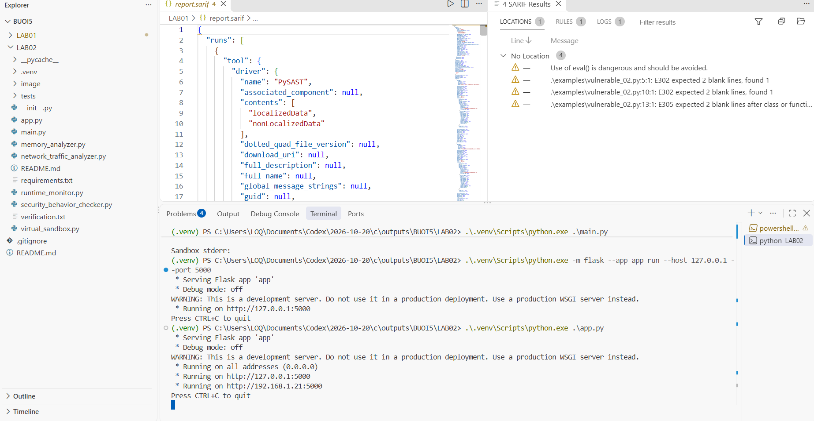

**GET /api/monitor:** ảnh người dùng xác nhận phản hồi JSON có `cpu_usage: 0.0`, `memory_usage: 38240256` và danh sách `open_files`.

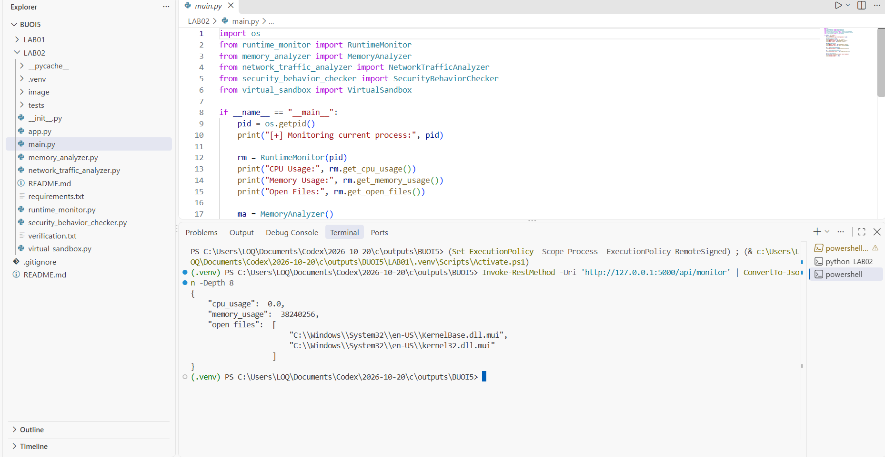

**GET /api/memory:** phản hồi có `memory_leaks: "[]"` và `overflow_test: true`, đúng kiểu dữ liệu trong mã gốc.

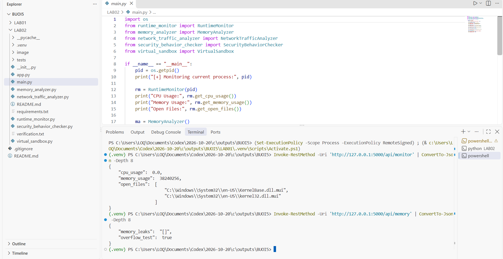

**GET /api/network:** ảnh phần cuối phản hồi cho thấy thống kê card VMware và Wi-Fi với các bộ đếm byte, gói, lỗi và gói bị bỏ. Lệnh gọi API xuất hiện phía trên; số liệu mạng thay đổi theo máy và thời điểm.

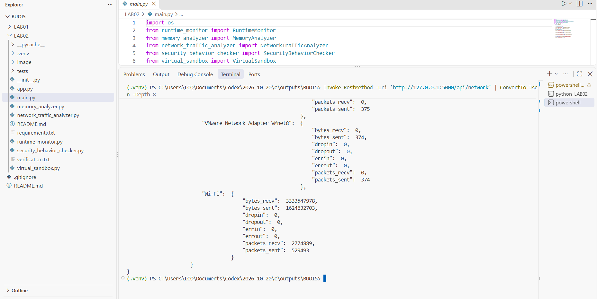

**GET /api/security:** phản hồi có đủ ba chuỗi `os.system`, `eval`, `exec` trong `suspicious_calls`.

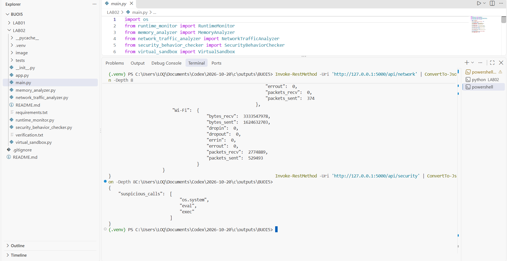

**POST /api/sandbox:** ảnh cho thấy gửi JSON chứa lệnh `echo Hello Sandbox`, nhận `stdout: "Hello Sandbox\r\n"` và `stderr: ""`. Ký tự `\r\n` là xuống dòng của echo trên Windows.

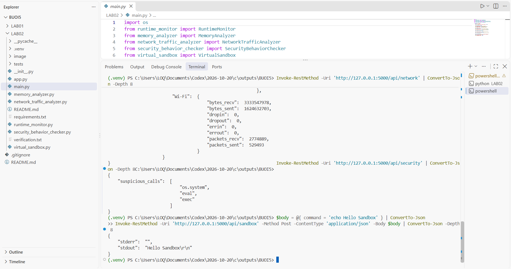

Đã đủ ảnh thực hành người dùng cho LAB02: cài thư viện, 5/5 unit test đạt, hai phần kết quả main.py, Flask chạy trực tiếp app.py và phản hồi thành công của 5 API. Ảnh Flask CLI được giữ làm minh chứng bổ sung. Sau khi xem xong kết quả API, chọn terminal chạy app.py và nhấn Ctrl+C để dừng server; ảnh hiện có chưa xác nhận thao tác dừng của người dùng.

## 8. Xử lý lỗi thường gặp

- `ModuleNotFoundError`: kiểm tra đang chạy Python trong `.venv` của LAB02 và đã cài requirements.
- `can't open file main.py`: terminal cần đứng trong `lab2/dast-tool`; dùng `Get-Location` để kiểm tra.
- `Address already in use`: dùng `--port 5001` và thay 5000 bằng 5001 ở toàn bộ URL gọi API.
- `Connection refused`: server chưa chạy hoặc đã dừng; xem terminal thứ nhất.
- `405 Method Not Allowed` ở sandbox: dùng POST như lệnh mẫu, không dùng GET.
- `404` ở `/`: dùng đúng `/api/monitor`, `/api/memory`, `/api/network`, `/api/security`, `/api/sandbox`.
- Số CPU bằng 0: có thể bình thường khi tiến trình rảnh; không cần sửa số liệu cho giống ảnh PDF.
- `AccessDenied` từ psutil: giữ việc giám sát tiến trình của chính bạn; ghi lại lỗi môi trường trước khi cân nhắc quyền bổ sung.
