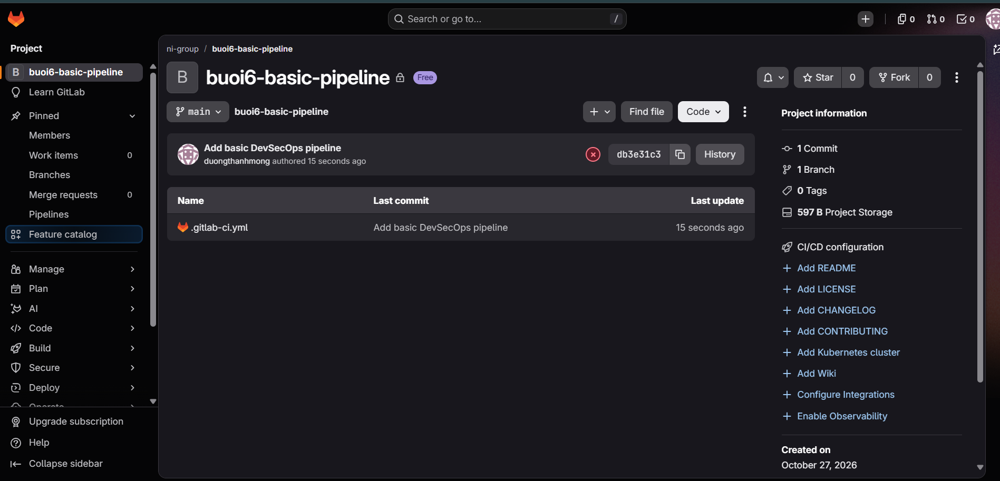
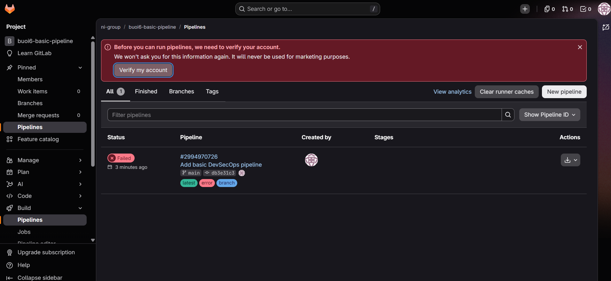
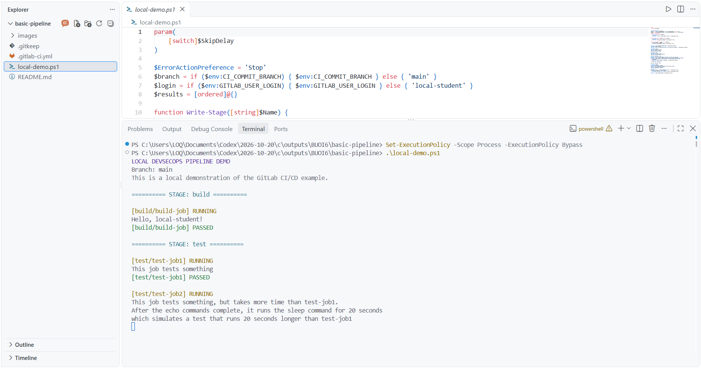
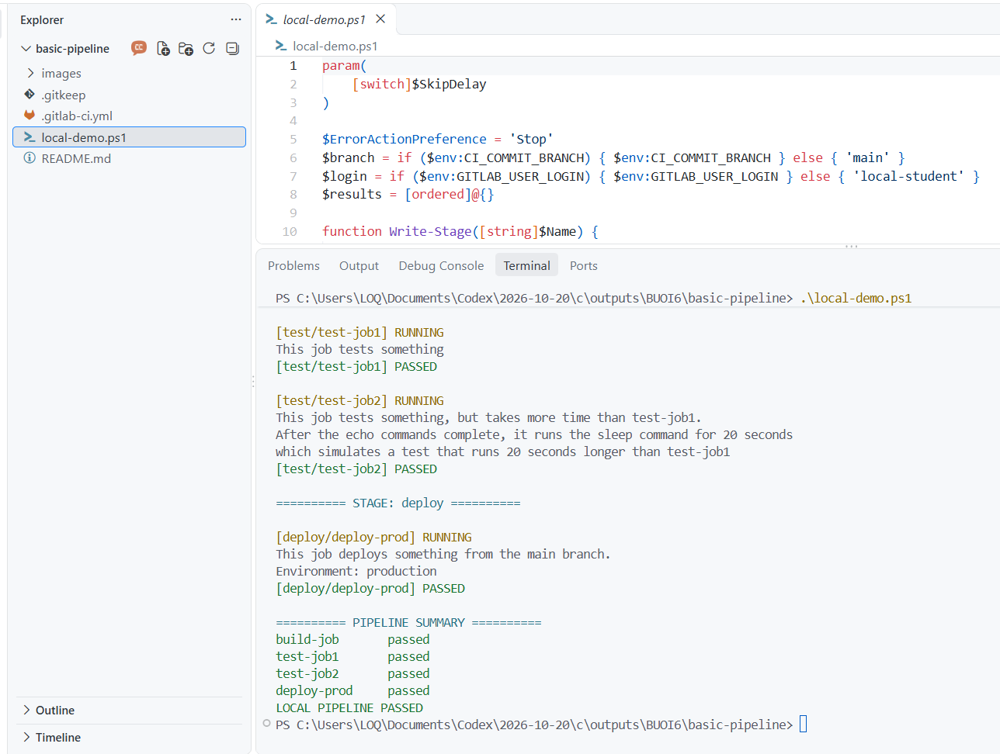

**MSSV:** 2387700044
**Họ và tên:** Dương Thanh Mộng
**Lớp:** 23DATA1
**Bài:** Bài 6 - Thực hành pipeline CI/CD cơ bản với GitLab

---

# Pipeline CI/CD cơ bản

Phần này bám mục 6.2.1 và các trang 5-9 của `lab-06 (1).pdf`. File `.gitlab-ci.yml` có ba stage và bốn job:

```text
build -> test -> deploy
```

- `build-job`: in lời chào và biến GitLab user.
- `test-job1`: chạy kiểm thử ngắn.
- `test-job2`: chạy kiểm thử minh họa dài hơn 20 giây.
- `deploy-prod`: in branch đang chạy và gắn environment `production`.

## Chạy trên GitLab

1. Truy cập GitLab và tạo một project mới, ví dụ `buoi6-basic-pipeline`.
2. Mở project → **Code → Repository**.
3. Chọn **+ → New file**.
4. Đặt tên file chính xác là `.gitlab-ci.yml`.
5. Mở file này trong VS Code, copy toàn bộ nội dung vào GitLab, rồi chọn **Commit changes**.
6. Mở **Build → Pipelines**. Pipeline mới sẽ có ba stage `build`, `test`, `deploy`.
7. Chọn pipeline ID để mở graph.
8. Chọn lần lượt `build-job`, `test-job1`, `test-job2`, `deploy-prod` để xem log.

## Demo cục bộ khi GitLab yêu cầu xác minh tài khoản

Nếu GitLab hiển thị thông báo `Before you can run pipelines, we need to verify your account` và pipeline hosted bị `Failed`, có thể chạy bản minh họa cục bộ trong VS Code. Bản này tái hiện đúng các stage, job, lệnh in và thời gian chờ của YAML giáo trình; nó được ghi nhận là **local demonstration**, không thay thế trạng thái pipeline GitLab thật.

Mở PowerShell tại thư mục `basic-pipeline` rồi chạy:

```powershell
Set-Location 'C:\Users\LOQ\Documents\Codex\2026-10-20\c\outputs\BUOI6\basic-pipeline'
.\local-demo.ps1
```

Nếu chỉ muốn kiểm tra nhanh mà không chờ 20 giây:

```powershell
.\local-demo.ps1 -SkipDelay
```

Ảnh local demo cần thấy tiêu đề `LOCAL DEVSECOPS PIPELINE DEMO`, ba stage, bốn job `PASSED` và dòng `LOCAL PIPELINE PASSED`. Ảnh này dùng để báo cáo thao tác cục bộ khi tài khoản GitLab chưa xác minh; không ghi chú là pipeline GitLab hosted.

## Ảnh cần chụp

Lưu ảnh vào thư mục `images/` của LAB này với tên sau:

| Tên ảnh | Màn hình cần thấy | Đối chiếu PDF |
|---|---|---|
| `01-basic-pipeline-graph.png` | Pipeline ID, ba stage và bốn job đều xanh | Trang 8 |
| `02-build-job-log.png` | Log `Hello, ...!` và trạng thái passed | Trang 7-9 |
| `03-test-job1-log.png` | Log `This job tests something` | Trang 7-9 |
| `04-test-job2-log.png` | Log sleep 20 seconds và trạng thái passed | Trang 7-9 |
| `05-deploy-prod-log.png` | Log branch và environment production | Trang 8-9 |

| `00-local-pipeline-demo.png` | Demo cục bộ ba stage và bốn job passed khi GitLab bị chặn xác minh | Bản thay thế có ghi chú |

## Ảnh đã ghi nhận

**Project đã commit `.gitlab-ci.yml`:**



**GitLab yêu cầu xác minh tài khoản trước khi chạy pipeline:** đây là lỗi điều kiện tài khoản, chưa phải lỗi YAML.



**Demo cục bộ đang chạy `test-job2`:** ảnh cho thấy job đang thực hiện phần chờ 20 giây theo mẫu giáo trình.



**Demo cục bộ hoàn tất:** cả bốn job đều `passed` và có dòng `LOCAL PIPELINE PASSED`.



Ảnh phải che token hoặc thông tin tài khoản nếu GitLab hiển thị. Không chụp access token trong URL, biến secret hoặc thông tin riêng tư không cần thiết.

## Kết quả mong đợi

Pipeline đạt khi `build-job`, `test-job1`, `test-job2` và `deploy-prod` đều ở trạng thái **passed**. Việc pipeline chạy được chứng minh runner của project có thể thực thi YAML; nó chưa tự chứng minh SAST, dependency scanning hoặc secret scanning vì pipeline mẫu của giáo trình chỉ là pipeline CI/CD cơ bản.
