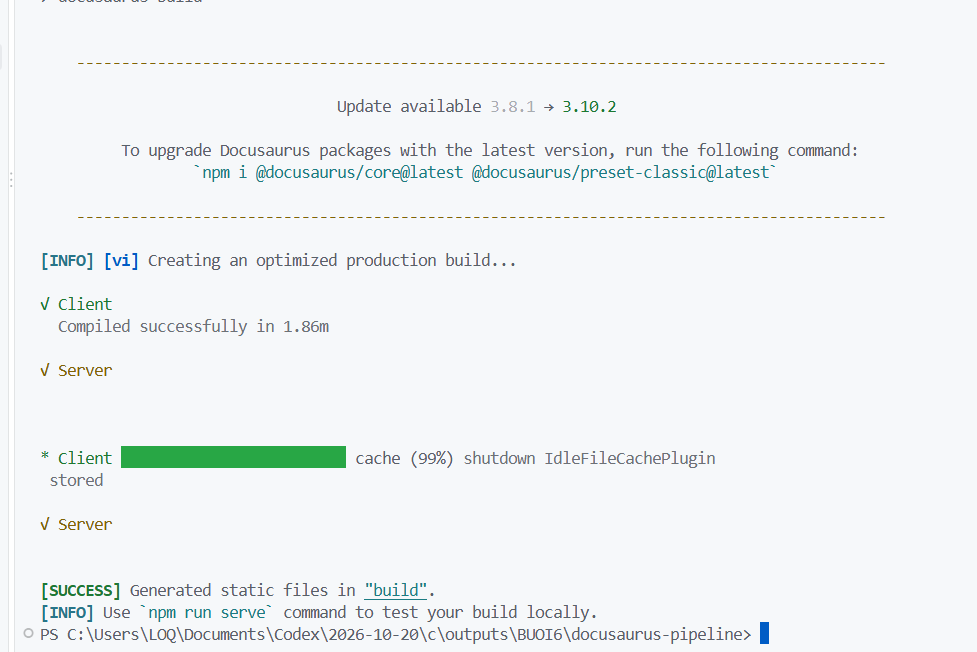
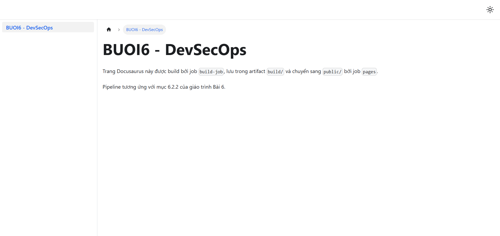
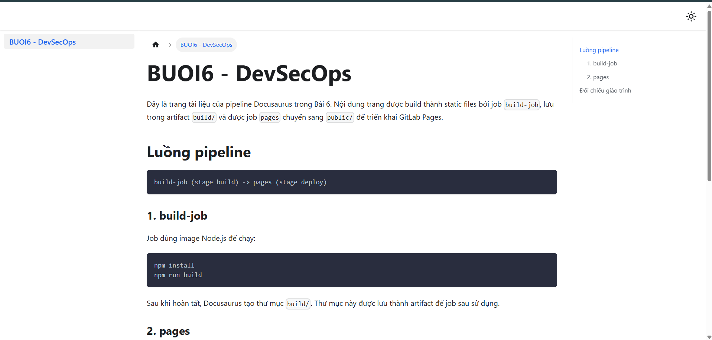
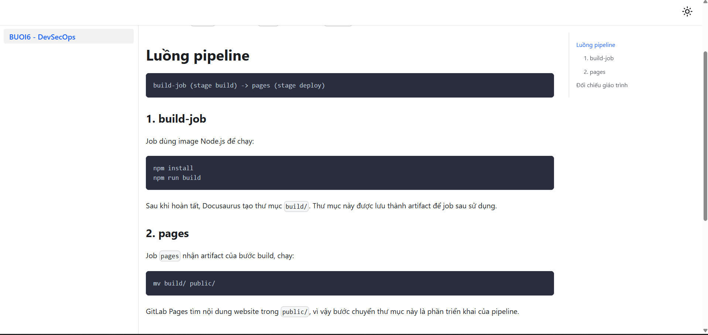
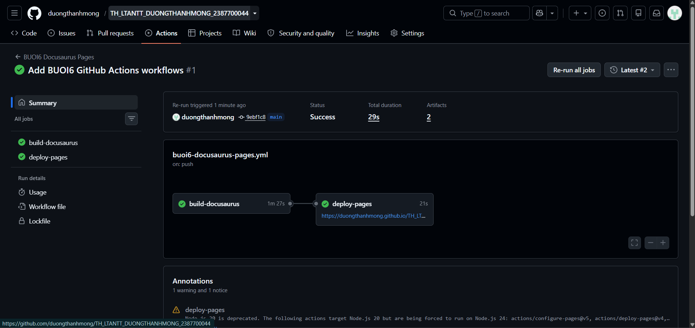

**MSSV:** 2387700044  
**Họ và tên:** Dương Thanh Mộng  
**Lớp:** 23DATA1  
**Bài:** Bài 6 - Thực hành pipeline Docusaurus và GitLab Pages

---

# Pipeline Docusaurus và GitLab Pages

Phần này bám mục 6.2.2 và các trang 10-15 của `lab-06 (1).pdf`. Giáo trình yêu cầu một dự án Docusaurus, job build tạo `build/`, lưu artifact, sau đó job `pages` chuyển `build/` thành `public/` để GitLab Pages triển khai. Kiểm tra cục bộ ngày 27/10/2026: `npm install` hoàn tất và `npm run build` tạo thành công thư mục `build/`; Webpack được pin `5.95.0` để tương thích với Docusaurus 3.8.1.

## Chuẩn bị project GitLab

1. Tạo project GitLab mới, ví dụ `buoi6-docusaurus-pipeline`.
2. Upload toàn bộ nội dung thư mục này vào gốc project, gồm `package.json`, `docusaurus.config.js`, `sidebars.js`, `docs/`, `src/`, `static/` và `.gitlab-ci.yml`.
3. Commit cả `package-lock.json` được tạo sau khi chạy `npm install`. Nếu đổi tên project hoặc username GitLab, sửa `url`, `baseUrl`, `organizationName` và `projectName` trong `docusaurus.config.js` trước khi commit.
4. Không đưa access token vào `package.json`, YAML, source code hoặc ảnh.

## Chạy pipeline

1. Commit các file lên branch mặc định.
2. Mở **Build → Pipelines** và chọn pipeline mới.
3. Chọn `build-job`, xem log `npm install` và `npm run build`.
4. Mở phần **Job artifacts** của `build-job`, chọn Browse để xác nhận có thư mục `build/`.
5. Chọn job `pages`, xem log `mv build/ public/` và artifact `public/`.
6. Mở **Deploy → Pages**. Nếu GitLab yêu cầu, tắt **Use unique domain** theo hướng dẫn PDF, sau đó chọn URL trong **Access pages**.

## Ảnh cần chụp

 Lưu ảnh vào thư mục `images/` của LAB này:

| Tên ảnh | Màn hình cần thấy | Đối chiếu PDF |
|---|---|---|
| `06-docusaurus-pipeline-graph.png` | Hai stage `build`, `deploy`, job `build-job` và `pages` passed | Trang 13-14 |
| `07-build-job-log.png` | Log `npm install`, `npm run build`, trạng thái passed | Trang 12-13 |
| `08-build-artifact.png` | Browse artifact có thư mục `build/` | Trang 12-13 |
| `09-pages-job-log.png` | Job `pages` passed và artifact `public/` | Trang 14 |
| `10-gitlab-pages.png` | Deploy → Pages, URL website và trang Docusaurus mở được | Trang 14-15 |

## Ảnh đã ghi nhận

**Build Docusaurus cục bộ thành công:** ảnh xác nhận Client và Server compile thành công, sau đó tạo static files trong thư mục `build/`. Đây là bằng chứng local cho bước `build-job`; GitLab hosted vẫn cần tài khoản đã xác minh để chạy runner.

**Website Docusaurus chạy cục bộ:** ảnh xác nhận địa chỉ local hiển thị trang `BUOI6 - DevSecOps`, tagline build artifact và nội dung pipeline.

**Trang tài liệu Docusaurus - phần đầu:** ảnh xác nhận route `/docs/intro`, mục `Luồng pipeline`, job `build-job` và phần đối chiếu giáo trình.

**Trang tài liệu Docusaurus - phần tiếp theo:** ảnh xác nhận job `pages`, artifact và lệnh `mv build/ public/`.

**GitHub Actions chạy thành công:** ảnh xác nhận `build-docusaurus` và `deploy-pages` đều passed, workflow có artifact và GitHub Pages đã triển khai.

Ảnh tổng hợp danh sách hai workflow GitHub Actions được lưu tại `images/10-github-actions-workflows-success.png`. Sau lần chạy thành công này, `baseUrl` được đặt theo đúng tên repository GitHub để tài nguyên website Pages tải đúng đường dẫn.

## Kết quả mong đợi

Pipeline đạt khi `build-job` và `pages` đều passed, artifact tồn tại, và URL Pages mở được trang **BUOI6 - DevSecOps**. Nếu runner không có Internet hoặc project không được phép chạy Pages, ghi nhận đúng lỗi GitLab trong README thay vì tự coi pipeline đạt.

